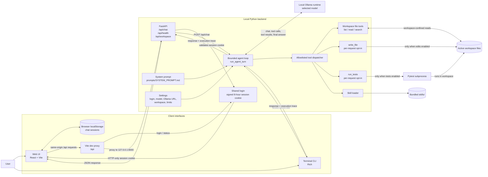

# CodePilot Architecture

## Request flow

- The web UI sends chat requests to FastAPI. The API calls the shared agent loop and returns its response, workspace, and tool trace.
- Browser login uses a shared server-configured username and password. Protected API routes require a signed, HTTP-only session cookie with an eight-hour lifetime.
- The terminal CLI calls the same agent loop directly; it does not send chat requests through FastAPI.
- The agent loop sends the conversation and currently enabled tool definitions to the configured local Ollama model. It dispatches allowlisted tool calls and returns a final response with the execution trace.
- File access is scoped to the active workspace. File edits and pytest execution are exposed only when enabled for the request. There is no general shell tool.
- The agent loads skill instructions from the bundled `skills/` directory when appropriate. The browser stores chat sessions in localStorage.
